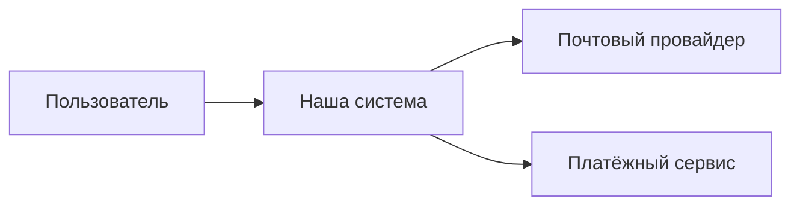
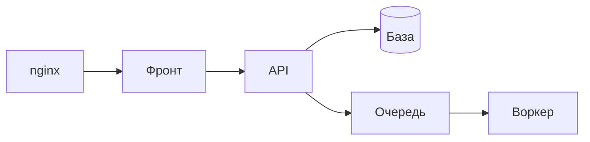
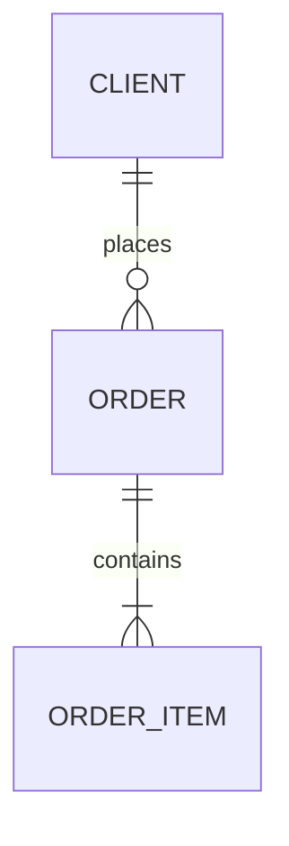
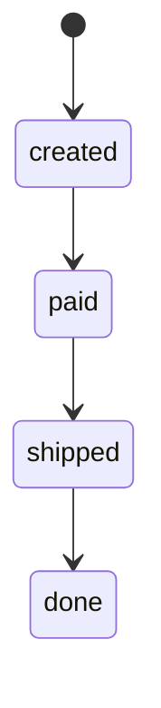

# Архитектура

Копируй в `docs/ARCHITECTURE.md`. Файл короткий и служит картой: схемы в Mermaid лежат в репозитории рядом с кодом и правятся вместе с ним. Если схема устарела, она хуже, чем её отсутствие: поэтому каждую меняет та задача, которая изменила описанное на ней.

## 1. Система и её окружение

Кто пользуется и с какими внешними системами она связана (платёжный сервис, почта, вход через стороннего провайдера, боты).

## 2. Контейнеры

Из чего система состоит при запуске и кто за что отвечает: веб-приложение, API, фоновые обработчики, база, очередь, хранилище файлов.

## 3. Компоненты важных частей

Только для частей, где границы ответственности легко нарушить (ядро и публичный интерфейс из `CLAUDE.md`). До отдельных классов не спускайся.

## 4. Данные

Основные таблицы, ключи, связи и их кратность, ограничения целостности. Реальная схема лежит в `docs/schema.sql` и миграциях, а эта диаграмма объясняет её. Расхождение с настоящей схемой проверяет сторож, а не память.

## 5. Состояния и сценарии

Только для сложного поведения: статусы объекта и запрещённые переходы, цепочки через несколько сервисов.

## Что менять вместе с кодом

В конце каждой существенной задачи сессия отвечает на пять вопросов и меняет то, на что ответила «да»:

1. Изменились ли границы компонентов?
2. Появились ли новые зависимости или внешние интеграции?
3. Изменилась ли модель данных?
4. Нужно ли править схему из этого файла?
5. Какие ещё документы надо поменять в том же коммите (`README`, `docs/DEPLOY.md`, ADR)?
